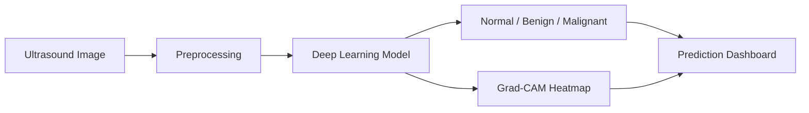

# 🩺 BUSI Breast Ultrasound Classifier

<p align="center">
  <strong>AI-Powered Breast Ultrasound Image Classification</strong>
  <br/>
  Deep Learning · Explainable AI · Medical Imaging
</p>

<p align="center">
  
  
  
  
  
</p>

---

## 🔬 Overview

A PyTorch-based deep learning project that classifies breast ultrasound images from the **BUSI dataset** into three categories:

| Class | Description |
|---|---|
| 🟢 Normal | Normal ultrasound images |
| 🔵 Benign | Non-malignant lesions |
| 🔴 Malignant | Malignant lesions |

The project emphasizes malignant sensitivity, explainable predictions, and reliable model evaluation.

## ✨ Key Features

- 🧠 **Multiple Architectures:** ResNet-18, ResNet-50, and EfficientNet-B2.
- ⚖️ **Focal Loss:** Helps address class imbalance and difficult examples.
- 🎯 **Sensitivity Tuning:** Configurable thresholds for malignant detection.
- 🔍 **Grad-CAM:** Visualizes image regions influencing model predictions.
- 📊 **Model Evaluation:** Malignant recall, ROC-AUC, and classification metrics.
- 🌐 **Flask Web App:** Interactive ultrasound image classification.

## 🏗️ Workflow



## 🚀 Quick Start

**1. Install dependencies**

```bash
pip install -r requirements.txt
```

**2. Prepare the BUSI dataset**

```text
data/Dataset_BUSI_with_GT/
├── benign/
├── malignant/
└── normal/
```

**3. Train the model**

```bash
python train.py --data_dir data/Dataset_BUSI_with_GT --epochs 35 --arch resnet50
```

**4. Launch the web application**

```bash
python app.py
```

Open [http://127.0.0.1:5000](http://127.0.0.1:5000).

## 📊 Evaluation

The project prioritizes:

- **Malignant Recall (Sensitivity):** Identifying malignant cases.
- **Macro ROC-AUC:** Measuring multiclass discrimination.
- **Precision, F1-score, and Confusion Matrix:** Assessing classification performance.

*Add experimentally measured results after evaluating the trained model.*

## ⚠️ Medical Disclaimer

**For educational and research purposes only.** This prototype is not a clinically validated diagnostic tool. Predictions and heatmaps must not replace professional medical evaluation or be used as the sole basis for clinical decisions.

## 🤝 Contributing

Contributions to improve model performance, explainability, evaluation, and reproducibility are welcome.

---

<p align="center">
  <strong>Building more explainable and responsible AI for medical imaging.</strong>
</p>
